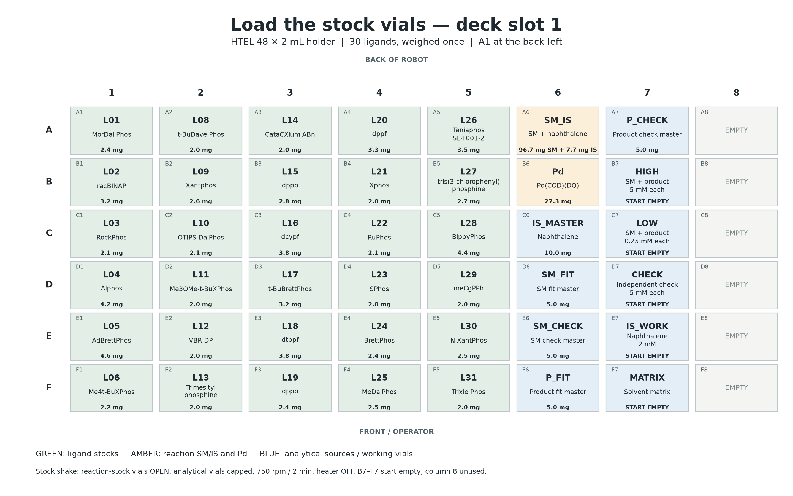
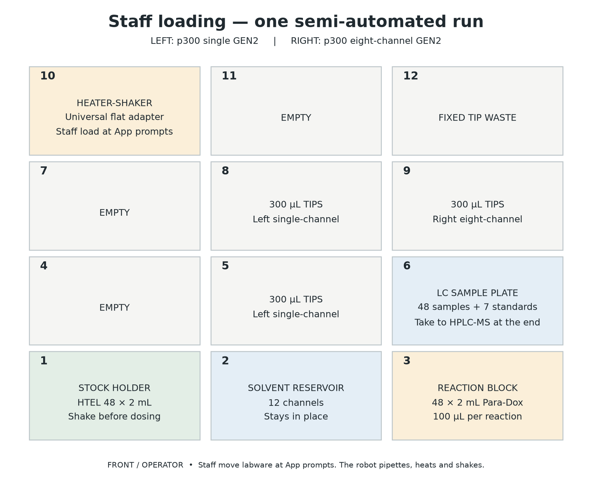

# HTE: one 48-reaction screen

**This is a semi-automated experiment.** Staff weigh chemicals, prepare two bulk liquids and load the OT-2. The robot adds stock solvents, doses reactions and prepares the LC samples. Staff handle caps and labware moves, then carry the finished plate to HPLC-MS.

**Follow [the numbered staff guide](run/README.md)** from weighing through HPLC-MS handoff and return of results. The App pauses use the same step numbers and state what staff must do before resuming.

| Task | File |
|---|---|
| Follow the experiment | **[Staff procedure](run/README.md)** |
| Weigh the chemicals | **[Weighing sheet](run/WEIGHING.md)** |
| Run every OT-2 stage | **[Download ready Python file](https://raw.githubusercontent.com/MiquelAngelPerezPuigdo/Agentic-AI-for-Dual-Ligand-Discovery/main/run/run_screen.py)** · [view code](run/run_screen.py) |
| Print the instructions | [Two-page bench sheet](run/bench-sheet.pdf) |
| Calculate yields | [LC analysis instructions](run/ANALYSIS.md) |

Plan for staff to be present during loading/dosing, at about **three hours** for calibration preparation, and from the **end of the heated hold through cooling, sampling and LC handoff**. The same labware and tip racks are used throughout.

**Ready for the local Opentrons App:** save the Python download as `run_screen.py`, import it, complete the App's setup/labware checks and start. The file already includes all custom labware definitions, stock volumes and the 48-pair dosing plan. HTE can use it directly without generating protocols or uploading CSV/JSON files to the robot.

Everything for the bench is in **`run/`**. Its `images/` and `tables/` subfolders support the linked instructions. No API key is needed.

**Stock-vial loading map — deck slot 1.** A1 is at the back-left. Each cell shows the vial position, reagent ID, name and mass to weigh; the five working vials in B7–F7 start empty.

| Stock-vial map — slot 1 | Robot deck |
|---|---|
|  |  |

Click either map to open it at full size.

Before dosing, leave the 30 ligand vials and SM_IS/Pd vials **open**, with analytical vials capped. Follow the App prompts to move the holder **1 → 10 → 1**. The robot shakes the stocks **750 rpm for two minutes, heater off**.

Used reaction stocks may remain open after dosing. Analytical vials stay capped until standards preparation, then may also remain open. Keep the reservoir and LC plate covered at the App prompts.

The reaction's heated hold is **nominally four hours**; longer holds or a wait before quenching are allowed and logged. Keep reaction vials sealed while the block cools in slot 3; confirm block/vials are **≤30 °C before opening**.

**Smallest liquid dose: 20 µL.** Each 100 µL reaction receives **20 µL SM/internal-standard stock + 30 µL ligand A + 30 µL ligand B + 20 µL Pd stock**.

Software and scientific records

[Build and test instructions](support/README.md) · [How the pairs were selected](support/research/METHOD.md) · [Selection evidence](support/campaigns/hackathon2026/)

Code, inputs, tests and historical material are grouped in `support/`. The root `pyproject.toml` and `uv.lock` install the analysis software using the commands in the LC instructions.

