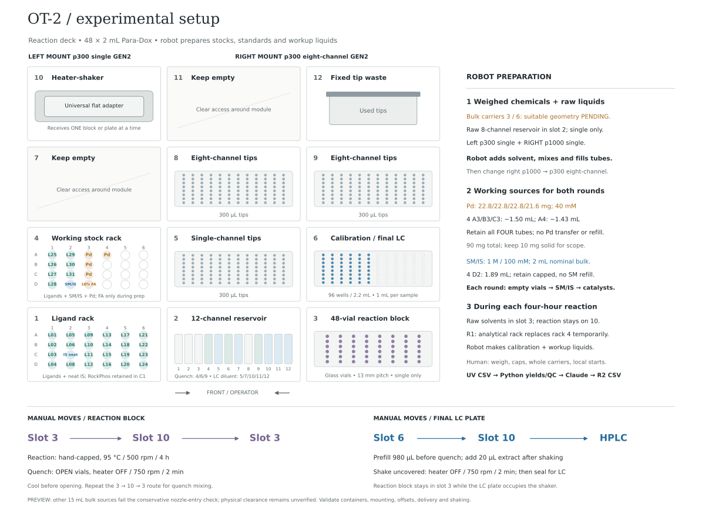

# Agentic AI for Dual-Ligand Discovery

A local OT-2 / LC workflow to search for productive dual-ligand systems in Pd-catalyzed desulfonylative fluorination of pyridine-2-sulfonyl fluoride to 2-fluoropyridine.

**Release status: preparation preview only.** The independent audit found that bottom aspiration in the configured 15 mL bulk tubes requires the pipette nozzle to enter far below the rim. Clearance and liquid contact are unverified; the conservative no-nozzle-entry check blocks live release pending suitable source geometry. [Audit and remaining evidence](docs/rehearsal-results.md).

## Start with your role

| Reader | Start here |
|---|---|
| HTE staff running the experiment | **[Two-page staff checklist](docs/HTE-staff-checklist.pdf)** |
| Colleague operating the local pipeline | **[Setup and run commands](docs/start-here.md)** |
| Chemistry / ML reviewer | **[ML/LLM strategy, equations and limitations](docs/ml-strategy.md)** |
| Developer | **[Architecture, testing and reproduction](docs/development.md)** |
| Stock / analytical preparation | [Stock and calibration recipes](docs/stocks-and-calibration.md) |

**The OT-2 prepares stocks from weighed chemicals and bulk solvents**, fills its working sources, doses each round into empty vials, prepares calibration standards and workup fluids during reaction holds, and refills ligand sources for R2. Staff handle weighing, coarse loading, caps, labeled labware moves, local starts and one pipette change.

The [four-page operator reference](docs/HTE-operator-handbook.pdf) covers the experiment, calibration and local pipeline. Its [Markdown sources remain editable](docs/updating-the-handbook.md).

## Campaign at a glance

**30 available ligands, 435 distinct unordered pairs.** Round one tests **48 pairs covering every ligand**. Round two tests **22 new pairs + one L17 tBuBrettPhos single-ligand reference**. Load the same 48-position Para-Dox block with **48 empty vials for R1, then 23 new empty vials for R2**. Each round starts with robotic SM/IS dosing, followed by catalysts; staff handle screw caps. Retain the combined SM/IS working tube **4 D2**, capped between rounds: **1.89 mL** loaded from the same nominal 2 mL stock covers both rounds without a refill.



[Download the setup figure as PNG](docs/figures/ot2-deck-setup.png). The deck map shows the pipetting positions; the block and LC plate occupy the heater-shaker sequentially.

Each reaction, nominal under the solvent-addition approximation: **250 µL, 0.1 M substrate, 95 °C /4 h, 6 mol% each ligand, 12 mol% Pd(COD)(DQ)**. Dose **25 µL combined 1 M SM /100 mM mesitylene in toluene**, then 75 µL each of two **20 mM ligand stocks** and 75 µL **40 mM Pd**. Solvent is retained. Prepare Pd directly in **four retained 2 mL tubes**: **22.8 mg each in 4 A3/B3/C3, 21.6 mg in 4 A4**. The robot adds ~1.50 mL toluene to each of the first three and ~1.43 mL to A4 at 100% assay; exact additions follow actual masses/assays. Total **90 mg**, ~5.94 mL nominal; keep **10 mg solid for scope**. No Pd bulk transfer or R2 refill. It makes the combined SM/IS stock with neat mesitylene. Working-source mixing is included. RockPhos L03 is limited to **four R2 wells**, with **10 mg available**. [Canonical configuration](hte_inputs/campaign.json), [remaining HTEL setup facts](docs/hte-questions.md).

The **[official initial batch](campaigns/hackathon2026/round1_design.csv)** uses **David Ming Segura's 24-consensus +24-Sobol initialization**: retain a diverse, all-ligand-covering subset of the Claude/T5 consensus, then explore 24 further pairs in scaled 16-dimensional PCA space. It reuses the paid Claude scores. Both scoring stages include ligand identities/SMILES and 17 available single-ligand SI yields; R2 remains Claude-only with all 48 measured R1 results. [Selection and provenance](campaigns/hackathon2026/README.md).

**[View the initialization map and statistics](docs/initialization-review.md)**: pair-space coverage, a ligand-pairing network, use counts for every ligand, and alternative weight previews from the same saved scores. All-ligand inclusion is enforced; use frequencies are unequal.

## Install and practice

Use Python 3.12 on the local workstation. With uv: `uv sync --locked --python 3.12 --extra sources --extra robot`, then `uv run hte check`. With an activated virtual environment:

```bash
python -m pip install -e '.[sources,robot]'
python -m hte.cli check
python -m hte.cli rehearse-loop --output output/practice
```

Practice uses synthetic yields and mocked Claude responses, with zero paid calls. Robot protocols, CSV setup files and practice outputs are generated locally under ignored `output/`; [setup commands](docs/start-here.md) produce the matching files. The frozen initial selection remains versioned.

The rehearsal includes HTEL-format peak exports, calibration and known-mixture challenges. Run only those with `python -m hte.cli practice-analytics --output output/analytics-practice`; [LC instructions](docs/htel-lc-import.md) cover the generated preparation tables and `verify-pilot` replay of actual HTEL files. HTEL supplies integrated UV areas; Python calculates calibrated concentrations and yields using mesitylene. No Chromeleon installation or vendor-calculated concentration file is required. Claude selects conditions after quantitative QC.

For a visual test, install `.[reports]` and run `python scripts/mock-hplc-trials.py --output output/mock-hplc`. Open the generated `mock-hplc-report.html` to compare 14 illustrative chromatograms with the pipeline's accepted, blocked and undetected-bias outcomes. No API calls or actual raw-trace integration are involved.

**API key:** create **`anthropic.key` in the repository root** from [the placeholder](anthropic.key.example), replacing its line with the raw key. Keep an existing key file. The pipeline reads it automatically; an environment `ANTHROPIC_API_KEY` takes precedence. Keys stay local and are excluded from Git and handoff packages.

**Return the data:** after staff save instrument logs/raw files and notes into `local_data/`, run `python scripts/hte-return-package.py`. Send `transfer/hte-results.zip` privately: code, local data, run outputs and file hashes, with credentials excluded. [What is saved and what staff must supply](docs/development.md#return-the-campaign-to-miquel). A Git push alone does not include experimental data.

Keep correspondence, meeting notes, registration details and team schedules outside this public repository. The shared documentation describes the project and its operating requirements.

## Evidence and scope

**Timing target: two 4 h reaction holds plus approximately 4 h for remaining tasks, including LC.** Stock preparation is inside the campaign; calibration and workup-fluid preparation overlap reaction holds. The target is advisory, and the present plan does not demonstrate a 12 h finish. Preparation manifests report a pumping/wait lower bound, excluding motion and staff handling. Use an external timer during heated manual pauses; the robot cannot enforce a deadline while paused.

Use one final LC plate per round, with automated dilution/shaking and direct plate injection; no R1 split. Calibration uses a separate plate, pipette-mixed during hold one. [Software evidence](docs/rehearsal-results.md) and [machine-readable record](software_validation.json) distinguish simulation from physical execution. Local mounting, source-container compatibility, pipetting and actual LC validation remain required.

The method combines repeated scoring from the [thesis benchmark](https://github.com/MiquelAngelPerezPuigdo/Agentic-AI-for-Catalyst-Design) with David's adaptation of [ALICE's representation/Sobol initialization](https://arxiv.org/abs/2609.11790). ALICE provides prior computational and experimental evidence for the broader approach; this exact hybrid and Claude-only feedback are being evaluated here. [Method and attribution](docs/ml-strategy.md). Original project code is [MIT licensed](LICENSE).
