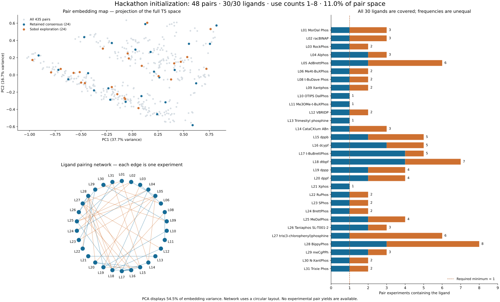

# Initial ligand-selection review

**Official R1: 24 retained consensus choices + 24 Sobol exploration choices.** All 30 available ligands occur at least once in the 48 pair experiments. L07 is excluded because it is unavailable.

## How this batch was selected

David's ALICE-inspired initialization first computes the existing 48-pair consensus batch (equal Claude-rank and raw-T5-diversity weights). It retains a diverse 24-pair subset that covers all available ligands, then matches 24 Sobol targets to distinct remaining candidates without a Claude-score floor. The retained subset is selected in the transformed embedding space; it is not simply the 24 highest Claude scores.

The sampling transform is standardization → 16-component PCA → 0–1 scaling, retaining 89.4% of standardized embedding variance. This is an initialization policy; no pair-yield model or Gaussian process is fitted. Measured R1 yields inform Claude-only R2 selection. ALICE provides methodological precedent, not evidence that this exact hybrid outperforms alternatives.

## Official-batch statistics

| Measure | Value |
|---|---:|
| Unique pair experiments | 48 /435 (11.0%) |
| Ligands covered | 30 /30 |
| Uses per ligand | 1–8; mean 3.2; median 3 |
| Mean Claude score, selected /whole library | 50.95 /45.05 |
| Median repeat-scoring SD, selected | 2.45 score units |
| Overlap with the unconstrained top 48 scores | 10 /48 |
| All-ligand coverage completed | Selection step 18 |
| Retained coverage choices overriding the score floor | 0 |
| Sobol choices below the preliminary consensus floor | 3 |
| Pairing-network components | 2 |
| Ligand-usage Gini (0 = equal use) | 0.305 |
| One-P + one-P ligand pairs | 19 |
| One-P + two-P ligand pairs | 23 |
| Two-P + two-P ligand pairs | 6 |

Phosphorus counts describe ligand structures, not proven denticity under reaction conditions; other donor atoms may also bind. In particular, a one-P ligand can support P,N coordination.

Ligands used once (4): **L10 OTIPS DalPhos**, **L11 Me3OMe-t-BuXPhos**, **L13 Trimesityl phosphine**, **L21 Xphos**.
Most-used ligands (8 times): **L28 BippyPhos**.

The displayed two-dimensional PCA retains **54.5%** of raw embedding variance. This display projection differs from the standardized 16-dimensional sampling transform. Points are pairs; network nodes are ligand IDs. All distance comparisons below use all 768 raw T5 dimensions so the methods share one diagnostic metric.

## Cached-score comparisons

| Method | Ligands covered | Uses | Mean score | Mean nearest squared distance | Usage Gini | Shared pairs |
|---|---:|---:|---:|---:|---:|---:|
| Official: 24 retained consensus + 24 Sobol | 30/30 | 1–8 | 50.95 | 0.1818 | 0.305 | 48/48 |
| Previous method: full consensus batch | 30/30 | 1–7 | 57.34 | 0.1708 | 0.326 | 26/48 |
| Hybrid preview: baseline 25% Claude weight | 30/30 | 1–8 | 49.82 | 0.1833 | 0.266 | 35/48 |
| Hybrid preview: baseline 75% Claude weight | 30/30 | 1–8 | 51.75 | 0.1944 | 0.286 | 37/48 |
| Diagnostic: top 48 scores, no coverage rule | 22/30 | 0–15 | 62.27 | 0.2456 | 0.574 | 10/48 |

Hybrid previews change the Claude weight in the preliminary consensus selector only; they preserve the 24+24 split and all-ligand coverage. Sobol choices are not restricted by the Claude-score floor. The top-score diagnostic omits coverage deliberately. No preview changes the official design, well assignments or stock plan.

Lower mean nearest squared distance indicates broader coverage in this particular representation; higher Claude scores indicate stronger model preference. Neither establishes experimental performance or the information value of a batch. Finite-candidate matching and coverage constraints do not preserve exact continuous Sobol balance guarantees.

Generate the self-contained interactive report and machine-readable statistics locally:

    python -m pip install -e '.[reports]'
    python scripts/initialization-report.py --output output/initialization-review

Open output/initialization-review/initialization-review.html. The folder also contains SVG/PNG, statistics.json, comparison.csv and ligand_counts.csv. No API key, GPU or paid calls are needed.

[ML strategy](ml-strategy.md) · [Exact official ligand coverage](../campaigns/hackathon2026/round1_design.csv.ligand_coverage.csv) · [ALICE paper](https://arxiv.org/abs/2609.11790) · [ALICE initializer](https://github.com/schwallergroup/alice/blob/cda460d627e074d3cd57c47df13df08cea9346c6/src/alice/initialization/initializers.py)

Design SHA-256: 3c68d4fe7429cd5b880cdbec25debd4fd6d6e794e95022c88c317c07c5d5dd27
