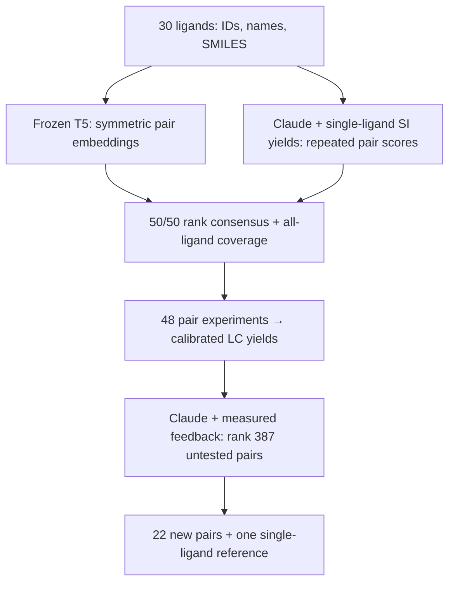

# ML/LLM strategy for expert review

This is a two-round, fixed-condition search over **435 unordered pairs of 30 available ligands**. A frozen text encoder supplies a diversity signal for initialization; repeated Claude scoring supplies a performance-prior signal. After experimental feedback, Claude alone ranks the remaining pairs. The implementation keeps model weights fixed throughout.



## Search space, evidence and objective

The objective is **calibrated product yield** for pyridine-2-sulfonyl fluoride → 2-fluoropyridine at 95 °C for four hours, 0.1 M, 250 µL toluene, 6 mol% of each ligand and 12 mol% Pd(COD)(DQ). All mixtures contain two different ligands. IDs are immutable; unavailable L07 is excluded, leaving C(30,2)=435 candidates. [Inventory](../hte_inputs/ligands.csv), [configuration](../hte_inputs/campaign.json).

The fixed prompt supplies every active ligand's **ID, name and SMILES**, SM/product chemical identities, conditions and **17 experimentally reported single-ligand yields for this substrate**. The other 13 values are null. CAS-matched evidence comes from Table S2, SI page S35 of [Hall et al., Chemical Science 2025](https://doi.org/10.1039/D5SC00912J); source values and extraction provenance are in [literature.json](../hte_inputs/literature.json). The published high-temperature conditions differ from the 95 °C target, and row-specific times are incompletely specified. These yields condition the chemical prior; no synthetic pair labels are derived from them. The same evidence is present in both scoring stages.

## 1. Frozen representations for initialization

For each pair {a,b}, construct two texts containing the ligand names/SMILES, with the order swapped, and the same reaction conditions. Run the frozen **[T5-base encoder](https://huggingface.co/google-t5/t5-base)** and average the last hidden states over non-padding tokens. Average the two order-specific vectors:

$$z_{ab}=\frac{1}{2}\left[\operatorname{MeanPool}(E(t_{a,b}))+\operatorname{MeanPool}(E(t_{b,a}))\right].$$

This produces an order-invariant **768-dimensional** representation. The included matrix has **435 ×768** entries; it is an exact active-ligand subset of the original model-inferred matrix. [Model revision and pooling metadata](../hte_inputs/pair_embeddings_t5-base.npz.metadata.json), [implementation](../hte/embeddings.py).

Distances use **squared Euclidean distance on the raw pooled vectors**, with no PCA, standardization or cosine normalization. The encoder supplies a learned text representation without hand-built ligand descriptors or quantum calculations. Its distance geometry is a design heuristic; chemical coverage or predictive accuracy has not been validated for this reaction.

The connection to **GoLLuM** is language-model representation plus diversity-based initialization, which can operate before pair yields exist. GoLLuM exposes several [initializers, including max-min](https://github.com/schwallergroup/gollum/blob/c418d7ed3c17e5995f503f6df7c26e9f7c58d09f/src/gollum/initialization/initializers.py). Our rank consensus and coverage rules below are project-specific. The active campaign uses no fitted surrogate, Gaussian process or acquisition function. Its post-feedback selector is entirely Claude scoring.

## 2. Small, repeated pair-scoring requests

The cached prompt contains the individual ligand catalogue; the final query supplies **one anchor ligand ID and at most eight distinct partner IDs**. Claude scores combining that anchor with each partner. It never receives a complete 435-pair catalogue. Canonical anchor IDs organize enumeration, so each unordered pair is scored once per repeat. Anchor role stays fixed; only partner order is shuffled across repeats, leaving possible anchor/cohort context effects.

The instruction explicitly asks Claude to assess **ligand cooperativity**, steric/electronic complementarity, coordination competition and catalyst stability. Cooperativity is a candidate explanation, not an assumed benefit. Extended thinking is disabled, reasoning text is not requested, and output is restricted to:

```json
{"scores":{"L02":61.5,"L03":72}}
```

Each key is a requested partner; the anchor is in the query. These numbers score the **pair**, on a 0-100 scale of relative promise. Their values are not calibrated yield predictions. Scores are aggregated directly across cohorts without a fitted cross-cohort calibration; consistency of the common scale is an assumption. The schema/parser rejects extra/missing/duplicate IDs, strings, booleans, nulls, nonfinite numbers and out-of-range scores. An incomplete response cannot release a selection. [Current prompt preview](claude-scoring-prompt.txt), [scoring implementation](../hte/scoring.py).

Each pair receives **five scores**. Cohort membership stays fixed across repeats, while partner order is shuffled deterministically. Store the arithmetic mean and sample standard deviation. The mean ranks performance promise; the SD describes repeat-to-repeat scoring variability and does not enter selection. It is neither experimental uncertainty nor a calibrated posterior uncertainty. Shared priors, fixed cohorts and the same model can correlate repeated scores. The initial run used **Claude Opus 4.8, 340 requests, 2,175 validated pair scores**.

## 3. Initial 48: performance/diversity consensus with coverage

The [selector](../hte/design.py) ranks pair mean scores into fixed percentiles U(p), using average ranks for ties. Default eligibility is U(p) >=0.25, removing the bottom quartile from ordinary selection.

At the first step, diversity is squared distance from the library centroid. After selecting set S, diversity becomes the distance to the nearest selected pair:

$$d(p,S)=\min_{q\in S}\|z_p-z_q\|_2^2.$$

Convert distances to percentiles D(p,S) over the currently eligible rank pool and maximize:

$$C(p,S)=0.5\,U(p)+0.5\,D(p,S).$$

The **50/50 setting weights two ranks in each decision**; it does not allocate half the wells to each method. Diversity is recomputed after every choice, so this is a greedy batch-design heuristic rather than two independent top lists.

First enforce coverage of every available ligand in pair wells. Among candidates that can complete coverage within the remaining well budget, prefer those above the LLM floor, then those covering the most unseen ligands, then maximize the same consensus score. If necessary, coverage may override the floor; every override is recorded. Fill the remaining wells by ordinary consensus. Deterministic ID tie-breaks make selection reproducible. A seeded shuffle then assigns selected conditions to physical wells.

The **frozen real selection** completed coverage in 16 steps and added 32 further pairs, for **48 unique pairs, 30/30 ligand coverage and zero floor overrides**. [Step-by-step trace](../campaigns/hackathon2026/round1_design.csv.selection.csv), [coverage counts](../campaigns/hackathon2026/round1_design.csv.ligand_coverage.csv). Coverage guarantees ligand inclusion, not balanced frequencies, exhaustive pair exploration or a globally optimal design.

The [initialization review](initialization-review.md) maps the frozen selection, reports individual ligand frequencies and compares score/diversity weights using the saved scores. Its PCA projection is for display only; all selection and distance statistics use the full vectors. Previews do not replace the frozen batch.

## 4. Experimental feedback → final 22

After all **48 first-round samples** have completed, integrated UV areas are normalized with explicit injection maps. Authentic SM/product standards at fixed mesitylene concentration establish quantitative response; calibration, sample identity, method/channel, peak assignment and analytical QC must pass. Missing/rejected measurements are not converted to zero. Configured censoring retains an upper bound. [LC handling](htel-lc-import.md), [analysis](../hte/analytics.py).

Claude receives the same fixed chemistry, ligand identities and single-ligand SI values, plus valid first-round pair observations and any bounds. It scores the **387 untested pairs**, again in small anchor/partner requests with five scores per pair. Select the top **22** by mean score, with deterministic tie-breaking, and append the configured **L17 single reference at 12 mol% total ligand**. No embedding-diversity term is applied in round two. [Feedback workflow](../hte/workflow.py).

This is in-context adaptation: measured observations change the prompt, while model weights remain fixed. The L17 reference is measured only in round two and is therefore absent from first-round feedback. A local CSV and standalone robot Python provide the next physical assignments; the algorithm does not remotely operate the OT-2.

## 5. Caching, budget and replay

Two stable blocks use explicit **one-hour prompt caching**: fixed chemistry/ligands/SI and shared measured feedback. The short anchor/partner query varies. Schemas/cohorts remain fixed across repeats; a real scoring response warms each group without an extra warm-up call. Cache hits depend on provider behavior and are checked through returned usage. [Anthropic caching documentation](https://platform.claude.com/docs/en/build-with-claude/prompt-caching).

Accepted initial scoring cost **\$2.7599745**, with **311/340 cache-hit requests**, 1,578,979 cache-read tokens and 147,721 cache-write tokens. Earlier rejected output and smoke tests bring known combined estimated usage to **\$3.387529**. [Usage audit](../campaigns/hackathon2026/scoring/cache_summary.json), [full cost provenance](../campaigns/hackathon2026/scoring/campaign_provenance.json).

The current per-campaign cap is **\$20**, using incremental conservative cold-cache reservations before each request and provider usage afterward. The initial all-miss bound was \$28.99; caching made its actual completion cheaper. No SDK retries are enabled; uncertain attempts require explicit review before repayment, and partial scores cannot select a batch. Usage-based estimates are not an account-wide spending limit. Cache/resume/budget records remain with each run. Initial scoring used two workers; feedback uses four. API latency and its five-minute schedule allowance remain unmeasured for real feedback.

## Reproduction and interpretation

The frozen initial scoring used prompt format 6. Current format 7 corrects the score instruction to refer to `partner_ligand_ids`, matching the query/schema already used; chemistry, evidence and scoring policy are unchanged. [Current prompt preview](claude-scoring-prompt.txt); the original accepted request remains in the frozen scoring record. This wording correction does not rerun scoring or replace the initial selection.

[The campaign folder](../campaigns/hackathon2026/README.md) retains repeated scores, mean/SD ranking, source hashes, model/settings, example request and selection trace. [Development commands](development.md) reproduce the initial design without an API call. Practice loops generate synthetic yields and mocked Claude responses only; they verify data flow and never establish chemical performance. The real second selection waits for experimental results.

A productive pair above the one L17 reference supports improvement relative to that reference under these conditions. The absence of repeats and both corresponding single-ligand controls limits claims about reproducibility and synergy. Results on this one substrate do not establish wider scope. Pretraining may contain related literature, so the recorded prompt does not establish literature-blind prediction. Relevant future evaluations include rank/yield association on measured wells, prospective hit rate, repeated best conditions and matched single-ligand comparisons; the present campaign has no empirical predictive-performance estimate. Retrospective correlations on the deliberately selected first round would be conditional on that selected set.

The repeated-scoring design follows the user's [thesis benchmark](https://github.com/MiquelAngelPerezPuigdo/Agentic-AI-for-Catalyst-Design). The frozen encoder, rank consensus, all-ligand constraint and prompt-only feedback policy are explicit, inspectable choices rather than fitted hyperparameters selected against these experimental yields.
