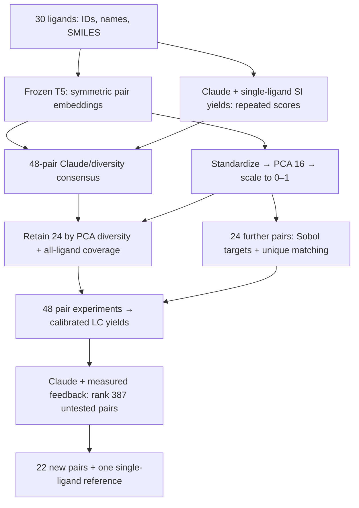

# ML/LLM strategy for expert review

This is a two-round, fixed-condition search over **435 unordered pairs of 30 available ligands**. The adopted initialization is **David Ming Segura's 24-consensus +24-Sobol design**, combining repeated Claude scores with frozen T5 representations. The retained 24 already cover every ligand; the other 24 can challenge Claude's prior. After experimental feedback, Claude alone ranks the remaining pairs. Model weights stay fixed throughout.



## Search space, evidence and objective

The objective is **calibrated product yield** for pyridine-2-sulfonyl fluoride → 2-fluoropyridine at 95 °C for four hours, 0.1 M, 250 µL toluene, 6 mol% of each ligand and 12 mol% Pd(COD)(DQ). All mixtures contain two different ligands. IDs are immutable; unavailable L07 is excluded, leaving C(30,2)=435 candidates. [Inventory](../hte_inputs/ligands.csv), [configuration](../hte_inputs/campaign.json).

The fixed prompt supplies every active ligand's **ID, name and SMILES**, SM/product chemical identities, conditions and **17 experimentally reported single-ligand yields for this substrate**. The other 13 values are null. CAS-matched evidence comes from Table S2, SI page S35 of [Hall et al., Chemical Science 2025](https://doi.org/10.1039/D5SC00912J); source values and extraction provenance are in [literature.json](../hte_inputs/literature.json). The published high-temperature conditions differ from the 95 °C target, and row-specific times are incompletely specified. These yields condition the chemical prior; no synthetic pair labels are derived from them. The same evidence is present in both scoring stages.

## 1. Frozen representations for initialization

For each pair {a,b}, construct two texts containing the ligand names/SMILES, with the order swapped, and the same reaction conditions. Run the frozen **[T5-base encoder](https://huggingface.co/google-t5/t5-base)** and average the last hidden states over non-padding tokens. Average the two order-specific vectors:

$$z_{ab}=\frac{1}{2}\left[\operatorname{MeanPool}(E(t_{a,b}))+\operatorname{MeanPool}(E(t_{b,a}))\right].$$

This produces an order-invariant **768-dimensional** representation. The included matrix has **435 ×768** entries; it is an exact active-ligand subset of the original model-inferred matrix. [Model revision and pooling metadata](../hte_inputs/pair_embeddings_t5-base.npz.metadata.json), [implementation](../hte/embeddings.py).

The baseline consensus uses squared Euclidean distance on the raw pooled vectors. David's retained subset and Sobol sampler use a second geometry: **standardize all 768 dimensions → PCA with 16 components → scale each component to [0,1]**. The components retain about **89.4% of standardized embedding variance**. Neither geometry is a validated measure of catalytic complementarity; the encoder avoids hand-built descriptors or quantum calculations.

David adapted the initialization from **ALICE**, whose [preprint](https://arxiv.org/abs/2609.11790) reports computational benchmarks and prospective HTE campaigns. Its [initializer](https://github.com/schwallergroup/alice/blob/cda460d627e074d3cd57c47df13df08cea9346c6/src/alice/initialization/initializers.py) implements standardization, optional PCA, scaling and unique matching of Sobol targets; its [palladium-Suzuki configuration](https://github.com/schwallergroup/alice/blob/cda460d627e074d3cd57c47df13df08cea9346c6/configs/pd_suzuki/pd_suzuki_llm.yaml) specifies T5-base, mean pooling and 16 PCA components. David is an ALICE coauthor and contributed the [campaign notebook](../notebook/batch_suggestions.ipynb).

This gives the initialization a traceable methodological precedent. The **24/24 hybrid, all-ligand coverage rule and Claude-only R2 are project-specific**; ALICE's reported results do not establish their superiority for this reaction. ALICE subsequently trains its language representation jointly with Gaussian-process surrogates; our workflow fits neither. The earlier GoLLuM connection is the same use of language-model representations without manual descriptors, not execution of its trained optimizer.

## 2. Small, repeated pair-scoring requests

The cached prompt contains the individual ligand catalogue; the final query supplies **one anchor ligand ID and at most eight distinct partner IDs**. Claude scores combining that anchor with each partner. It never receives a complete 435-pair catalogue. Canonical anchor IDs organize enumeration, so each unordered pair is scored once per repeat. Anchor role stays fixed; only partner order is shuffled across repeats, leaving possible anchor/cohort context effects.

The instruction explicitly asks Claude to assess **ligand cooperativity**, steric/electronic complementarity, coordination competition and catalyst stability. Cooperativity is a candidate explanation, not an assumed benefit. Extended thinking is disabled, reasoning text is not requested, and output is restricted to:

```json
{"scores":{"L02":61.5,"L03":72}}
```

Each key is a requested partner; the anchor is in the query. These numbers score the **pair**, on a 0-100 scale of relative promise. Their values are not calibrated yield predictions. Scores are aggregated directly across cohorts without a fitted cross-cohort calibration; consistency of the common scale is an assumption. The schema/parser rejects extra/missing/duplicate IDs, strings, booleans, nulls, nonfinite numbers and out-of-range scores. An incomplete response cannot release a selection. [Current prompt preview](claude-scoring-prompt.txt), [scoring implementation](../hte/scoring.py).

Each pair receives **five scores**. Cohort membership stays fixed across repeats, while partner order is shuffled deterministically. Store the arithmetic mean and sample standard deviation. The mean ranks performance promise; the SD describes repeat-to-repeat scoring variability and does not enter selection. It is neither experimental uncertainty nor a calibrated posterior uncertainty. Shared priors, fixed cohorts and the same model can correlate repeated scores. The initial run used **Claude Opus 4.8, 340 requests, 2,175 validated pair scores**.

## 3. Initial 48: 24 retained consensus +24 Sobol

The [production selector](../hte/initialization.py) reproduces David's default notebook proposal from cached vectors and scores, with **16 PCA components, scrambled Sobol seed 1 and 24 retained pairs**. No API call, model download or GPU is needed to reproduce the released batch.

1. **Construct the 48-pair baseline.** Rank Claude mean scores into percentiles U(p). Normally exclude the bottom quartile. Greedily combine U(p) and a diversity percentile D(p,S) with equal weight: C(p,S)=0.5 U(p)+0.5 D(p,S). Diversity is squared distance from the library centroid initially, then distance to the nearest selected pair, in the raw 768-dimensional vectors. Enforce all-ligand coverage first; record any required score-floor override.
2. **Retain 24 from that baseline.** Use diversity in the scaled 16-dimensional PCA space, with coverage taking priority. The first distance is from the baseline subset centroid; subsequent distances are to the nearest retained pair. Claude scores break diversity-rank ties. The adopted retained subset already covers all 30 ligands.
3. **Add 24 Sobol-selected pairs.** Generate scrambled Sobol targets in the 16-dimensional unit box using SciPy, seed 1; take the first 24 of 32 generated targets. Repeatedly choose the globally closest unused target–candidate pair and remove both. All unselected candidates are eligible, including those below the baseline Claude cutoff. The 24 retained pairs cannot be selected again.
4. **Validate and assign wells.** Require 48 unique pairs, no unavailable ligands and coverage of all 30. A seeded shuffle assigns sample IDs and physical wells; stock, dose and LC files use those assignments.

The **24/24 split counts experiments**, whereas the baseline's internal **50/50 weights ranks**. These are separate settings. Exploration can therefore select pairs Claude considers unpromising, giving experimentally unexpected ligand cooperativity an opportunity to update R2.

The adopted batch retains **26 of the previous 48 pairs** and replaces 22: 24 retained deliberately, plus two baseline pairs recovered by Sobol. It includes **three pairs below the baseline's usual Claude cutoff**. These are intentional exploratory choices, not coverage overrides. All **30/30 ligands** occur, with frequencies **1–8**; RockPhos occurs twice in R1 and remains limited to four R2 wells. [Selection trace](../campaigns/hackathon2026/round1_design.csv.selection.csv), [coverage counts](../campaigns/hackathon2026/round1_design.csv.ligand_coverage.csv).

The [initialization review](initialization-review.md) maps the official selection and reports ligand frequencies. Two-dimensional plots are projections; selection uses the full 16-dimensional scaled space for retention/Sobol and the raw vectors for the baseline. Exact continuous Sobol balance guarantees do not survive taking 24 targets and matching them to finite candidates. Coverage ensures inclusion, not balanced use or demonstrated chemical diversity. No experimental result yet establishes that this hybrid outperforms the previous consensus, random sampling or MaxMin.

## 4. Experimental feedback → final 22

After all **48 first-round samples** have completed, integrated UV areas are normalized with explicit injection maps. Authentic SM/product standards at fixed mesitylene concentration establish quantitative response; calibration, sample identity, method/channel, peak assignment and analytical QC must pass. Missing/rejected measurements are not converted to zero. Configured censoring retains an upper bound. [LC handling](htel-lc-import.md), [analysis](../hte/analytics.py).

Claude receives the same fixed chemistry, ligand identities and single-ligand SI values, plus valid first-round pair observations and any bounds. It scores the **387 untested pairs**, again in small anchor/partner requests with five scores per pair. Select the highest-ranked **22 feasible pairs** by mean score, skipping candidates after **four R2 uses of L03 RockPhos**, with deterministic tie-breaking, and append the configured **L17 single reference at 12 mol% total ligand**. No embedding-diversity term is applied in round two. [Feedback workflow](../hte/workflow.py).

RockPhos has only 10 mg available. The four-well R2 cap is enforced by Python during selection and CSV validation; stock planning also rejects a preparation exceeding available mass. Other ligands retain generous reserves.

This is in-context adaptation: measured observations change the prompt, while model weights remain fixed. The L17 reference is measured only in round two and is therefore absent from first-round feedback. A local CSV and standalone robot Python provide the next physical assignments; the algorithm does not remotely operate the OT-2.

## 5. Caching, budget and replay

Two stable blocks use explicit **one-hour prompt caching**: fixed chemistry/ligands/SI and shared measured feedback. The short anchor/partner query varies. Schemas/cohorts remain fixed across repeats; a real scoring response warms each group without an extra warm-up call. Cache hits depend on provider behavior and are checked through returned usage. [Anthropic caching documentation](https://platform.claude.com/docs/en/build-with-claude/prompt-caching).

Accepted initial scoring cost **\$2.7599745**, with **311/340 cache-hit requests**, 1,578,979 cache-read tokens and 147,721 cache-write tokens. Earlier rejected output and smoke tests bring known combined estimated usage to **\$3.387529**. [Usage audit](../campaigns/hackathon2026/scoring/cache_summary.json), [full cost provenance](../campaigns/hackathon2026/scoring/campaign_provenance.json).

The current per-campaign cap is **\$20**, using incremental conservative cold-cache reservations before each request and provider usage afterward. The initial all-miss bound was \$28.99; caching made its actual completion cheaper. No SDK retries are enabled; uncertain attempts require explicit review before repayment, and partial scores cannot select a batch. Usage-based estimates are not an account-wide spending limit. Cache/resume/budget records remain with each run. Initial scoring used two workers; feedback uses four. API latency and its five-minute schedule allowance remain unmeasured for real feedback.

## Reproduction and interpretation

The frozen initial scoring used prompt format 6. Current format 7 corrects the score instruction to refer to `partner_ligand_ids`, matching the query/schema already used; chemistry, evidence and scoring policy are unchanged. [Current prompt preview](claude-scoring-prompt.txt); the original accepted request remains in the frozen scoring record. This wording correction does not rerun scoring. David's adopted initialization changes the selection while preserving those paid scores and their provenance.

[The campaign folder](../campaigns/hackathon2026/README.md) retains repeated scores, mean/SD ranking, source hashes, model/settings, example request and selection trace. [Development commands](development.md) reproduce the initial design without an API call. Practice loops generate synthetic yields and mocked Claude responses only; they verify data flow and never establish chemical performance. The real second selection waits for experimental results.

A productive pair above the one L17 reference supports improvement relative to that reference under these conditions. The absence of repeats and both corresponding single-ligand controls limits claims about reproducibility and synergy. Results on this one substrate do not establish wider scope. Pretraining may contain related literature, so the recorded prompt does not establish literature-blind prediction. Relevant future evaluations include rank/yield association on measured wells, prospective hit rate, repeated best conditions and matched single-ligand comparisons; the present campaign has no empirical predictive-performance estimate. Retrospective correlations on the deliberately selected first round would be conditional on that selected set.

The repeated-scoring design follows the user's [thesis benchmark](https://github.com/MiquelAngelPerezPuigdo/Agentic-AI-for-Catalyst-Design). The frozen encoder, baseline consensus, PCA/Sobol initialization, all-ligand constraint and prompt-only feedback policy are explicit choices made before measuring these experimental yields.
